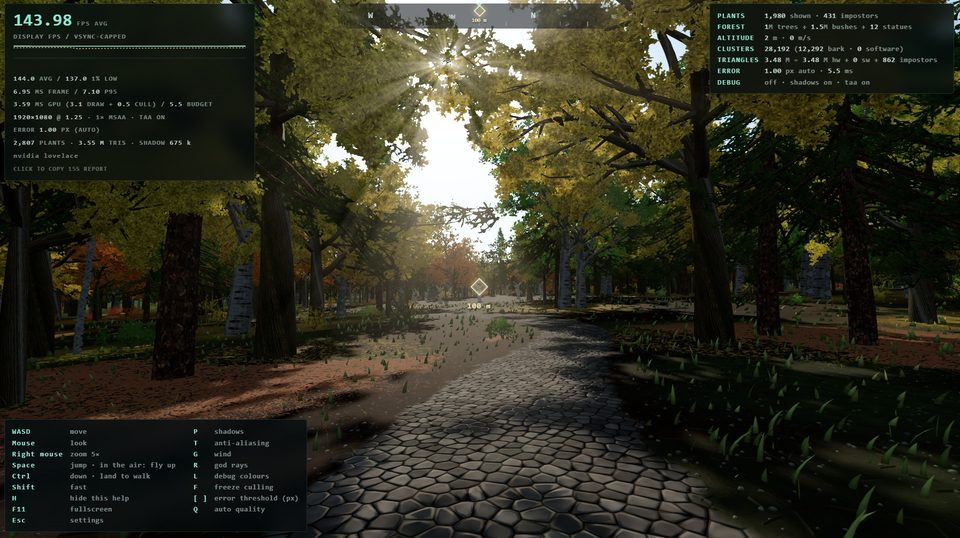
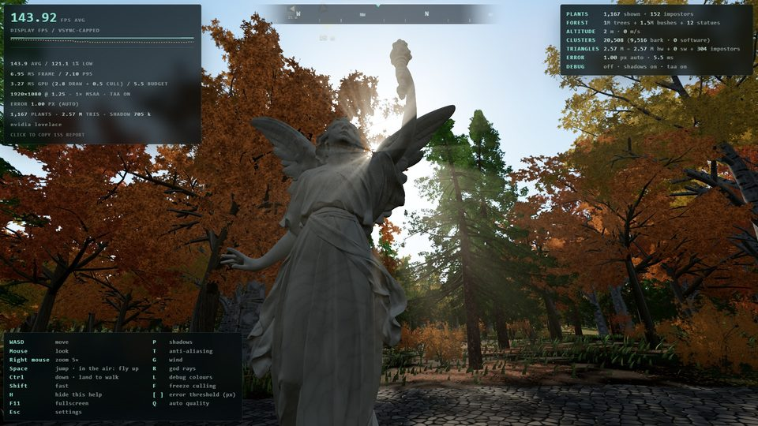
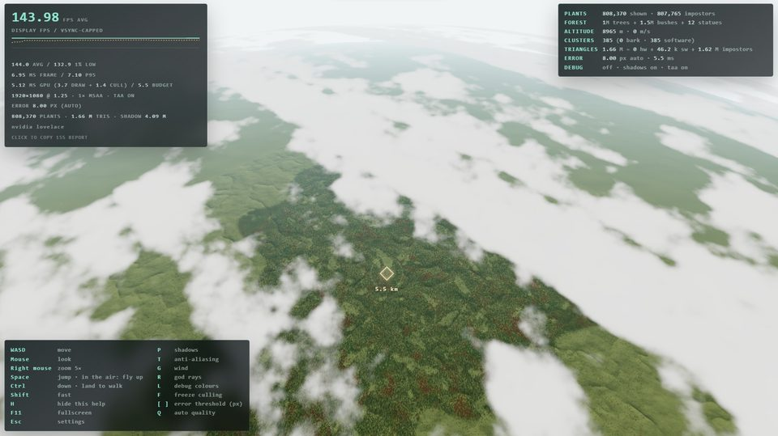
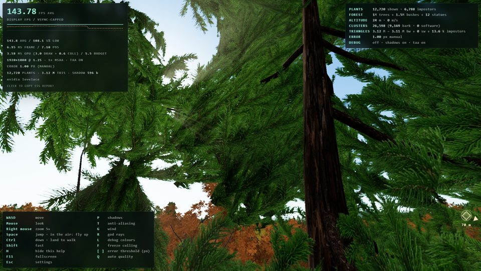

# Nanite Forest

A three.js (WebGPU) tech demo: a forest of 1M trees and 1.5M bushes, on a curved planet, drawn with a Nanite-style,
GPU-driven cluster LOD system. Fly from the forest floor to 9 km up. Trees are generated with
[ez-tree](https://github.com/dgreenheck/ez-tree).

**Live:** https://victorzakharov.github.io/threejs-nanites/

Needs WebGPU: Chrome / Edge on desktop and Android, Safari 26 on macOS and iOS.

| | |
|---|---|
|  |  |
| The road from the start, at eye height: 3.5M triangles, GPU 3.6 ms | A [Lucy](http://graphics.stanford.edu/data/3Dscanrep/) statue on the plaza (Stanford's scan, 1M triangles through the same cluster LOD) |
|  |  |
| 9 km up: 808k plants, drawn as impostors (only the 12 statues stay geometry); GPU 5.1 ms | Inside a pine's crown, 24 m up, at full detail (τ = 1 px) |

*RTX 4070 Ti at 1920×1080, 144 fps (vsync-capped).*

## Features

**Rendering (Nanite-style, everything on the GPU)**
- **Cluster DAG LOD for every plant:** 128-triangle clusters, simplified level by level, with the cut chosen per
  cluster each frame so the image moves by at most τ pixels (default 1). There's no per-tree LOD switch and no cracks.
- **GPU-driven culling and LOD selection** in compute passes: chunk, tree and cluster frustum culling, then DAG cut
  selection. Draws are indirect, with vertex pulling from storage buffers. No CPU round trip per frame.
- **Two-phase occlusion culling** against a hierarchical depth buffer (HZB), built from last frame's depth, then
  this frame's.
- **Software rasterizer** for clusters whose triangles are smaller than a few pixels: a visibility buffer built
  with 32-bit atomics, then shaded by a fullscreen pass with the same lighting.
- **Impostors** for distant trees:
  - Baked at startup from four elevations (0–90°), as albedo plus normals, and lit like the real trees.
  - Each tree switches at its own size, cross-faded with a dither.
  - They cast shadows too.
- **Shadows:**
  - A sun shadow map with its own culling pass and coarser LOD.
  - It only draws the casters whose shadow can land in view.
  - Its size follows the resolution and its extent the altitude.
  - Past its edge, an average canopy shadow takes over.
- **Any mesh, not just trees:** twelve copies of Stanford's [Lucy](http://graphics.stanford.edu/data/3Dscanrep/) scan (1M triangles each) go through the same pipeline.
- **Temporal anti-aliasing:**
  - Jittered camera, reprojection from depth, and wind motion vectors for the leaves.
  - History clipped in YCoCg and blended in a perceptual space.
  - Leaf edges use dithered alpha-to-coverage, so there's no MSAA cost.
- **Auto quality:** steers τ and the resolution to keep GPU time within a budget: 5.5 ms on desktop (144 Hz),
  14 ms on phones.

**World**
- **Plants:** 1M trees (six ez-tree variants: oak, ash, aspen, pine) and 1.5M bushes (three variants), with wind.
  They're planted in web workers, with clearings and denser forest edges.
- **Autumn:** stands of green, yellow and red trees. The fallen leaves on the ground match the tree above them in
  shape and colour.
- **Forest floor:** soil, twigs, pebbles, leaves and needles, with parallax-occlusion relief.
- **Grass:** blades in three rings around the viewer, with wind.
- **The planet:** curved, radius 150 km, with terrain out to ~65 km, sky-coloured fog, a cloud deck at ~2.2 km and
  god rays.
- **The plaza:** a cobblestone road from the start to a ring of statues, with a waypoint and a compass.
- **Moving around:** walk, jump and fly; touch controls on phones.
- **Music:** ez-tree's ambience track, looped. It starts on the first click, tap or key.

**Tools**
- A performance panel: FPS, the 1% low, frame and GPU time. A click copies a report.
- Profile GPU: the cost of each feature, measured by switching it off in turn.
- A settings menu with quality presets and debug colours (clusters, DAG level, trees, types, software-rasterized
  pixels).
- A headless benchmark harness (see below).

## Controls

Click to capture the mouse; Esc releases it and opens the settings. F11, or the settings' button, toggles
fullscreen. You start on foot.

| Key | |
|---|---|
| WASD / mouse | walk or fly / look |
| Right mouse (hold) | zoom 5× |
| Space | jump; again in the air: fly (Space / Ctrl: up / down) |
| Ctrl | down; fly onto the ground to walk again |
| Shift | fast (speed also builds up the longer you hold a key) |
| L | debug colours: clusters / DAG level / trees / tree types / software-rasterized pixels |
| F | freeze culling (fly around and inspect what was selected) |
| [ ] | error threshold τ in pixels (turns auto quality off) |
| Q | auto quality on/off |
| P / T / G / R / H | shadows / anti-aliasing (TAA) / wind / god rays / help |
| M | music on/off (remembered in this browser) |
| Esc | settings menu: quality presets, every switch, Profile GPU, fullscreen |

On a phone or tablet:
- The left thumb is a movement stick (push further to go faster).
- The right thumb drags to look.
- The buttons on the right are up (jump, then fly) / down / 5× zoom.
- The gear opens the settings; ♪ turns the music on or off.

`?touch=1` / `?touch=0` forces the touch controls on or off.

The panel at the top left shows the average FPS and the 1% low over the last 15 s, frame time, GPU time (draw +
culling) and the quality. Click or tap it to copy a performance report; Settings → Profile GPU adds the per-feature
breakdown to it.

### URL parameters

| Parameter | Default | What it does |
|---|---|---|
| `trees` | 1000000 | number of trees (bushes: `bushes` per tree) |
| `bushes` | 1.5 (0.5 on touch) | bushes per tree |
| `tau` | 1 | error threshold in pixels (auto quality changes it) |
| `auto` | 1 | auto quality (0 = off) |
| `budget` | 5.5 (14 on touch) | GPU budget for auto quality, in ms |
| `pr` | device pixel ratio, max 1.5 | pixel ratio |
| `planet` | 150000 | planet radius in m |
| `shadows` | 1 | 0 = no shadows |
| `smap` | by resolution | shadow map size |
| `grass` | 1 (0.5 on touch) | grass ring scale (0 = off) |
| `relief` | 32 (0 on touch) | forest-floor parallax steps (0 = off) |
| `autumn` | on | 0 = summer |
| `taa` | 1 | 0 = no TAA (4× MSAA instead) |
| `msaa` | | 4 = MSAA instead of dithered leaf edges |
| `occ`, `sw`, `imppx` | | 0 = no occlusion culling / no software rasterizer / no impostors |
| `debug` | 0 | 1–5: the debug colours |
| `music` | 1 | 0 = start muted |

## How it works

**At startup (web workers)**
- **Bark:** each tree variant's bark mesh is split into 128-triangle clusters (meshoptimizer). Then, repeatedly:
  groups of ~8 adjacent clusters are merged, simplified to half (the vertices shared with other groups locked, so
  no cracks between LODs) and re-split. That gives a cluster DAG.
  - A group's error is the larger of its children's and its own simplification's, as in Nanite. Each switch then
    moves the image by at most τ.
  - Summing them (meshoptimizer's demo) kept far trees' bark several levels too fine.
- **Leaves:** alpha-tested cards that can't be edge-collapsed. Each coarser level keeps half the cards and grows
  them until they cover what the whole group did.
  - Coverage is counted on a CPU raster of the cards through the leaf texture's alpha, from four directions.
  - Growing them to keep their total area (√2 per level) covered far more, because a crown's leaves overlap a lot.
    Each coarser level closed the gaps, and at coarse τ the forest turned into a bright carpet.
- **Impostors:** atlas tiles baked from each variant at the LOD it has where it turns into an impostor.
- **Planting:** the forest is planted in 512 m tiles across workers.

**Per frame (GPU compute, then indirect draws)**
1. **Chunks:** runs of up to 2048 instances (a planting tile's plants, in Morton order) are frustum- and
   distance-tested on the CPU. Only the chunks in view go to the GPU.
2. **Instance pass:** tests each tree against the frustum and last frame's HZB, and picks geometry or impostor.
   For a geometry tree it emits work items only for the clusters that could be selected: clusters are sorted by
   parent error, so a binary search gives the prefix.
3. **Cluster pass:** picks the DAG cut (`own error ≤ τ < parent error`, projected to pixels), frustum- and
   occlusion-tests each cluster, and appends it to the hardware draw lists or, if its triangles are tiny, to the
   software rasterizer's list.
4. **Phase 1 draw:** two indirect draws (bark, indexed leaves), each instance one cluster. The vertex shader pulls
   its triangles from storage buffers.
5. **Occlusion:** the HZB is rebuilt from this frame's depth, and whatever failed the old one is retested.
   - Foliage gaps up to 2 px are closed first; otherwise the gaps let far depth into every block and nothing
     tests hidden.
   - Each sphere grows by the wind's reach at its height.
   - What passes is drawn in phase 2, with the impostors (tested once, against this frame's HZB).
6. **Software rasterizer:** a compute pass rasterizes the tiny clusters into a visibility buffer (depth, then
   triangle id); a fullscreen pass shades it. It only runs from 25 m above the ground up, where far trees are many
   and small.
7. **Shadow map:** the same culling and LOD passes for the sun, at a coarser τ, for the casters whose shadow can
   land in view.
8. **Then:** god rays, and the TAA resolve.

All of a stage's compute dispatches run in one compute pass. Each shader binds at most 8 storage buffers (WebGPU's
guaranteed minimum; a Mac allowed no more).

**Any mesh:** `npm run model -- scan.ply --name=NAME --tris=1000000 --height=4`:
- Stands a PLY up, decimates it, builds its cluster DAG and writes both into one meshopt-compressed file
  (`public/models/NAME.nm`; the site only decodes it).
- A variant with `model: 'models/NAME.nm'` (`src/trees.ts`) then gets cluster LOD, shadows and occlusion like a tree.
- The demo's proof is twelve copies of Stanford's **[Lucy](http://graphics.stanford.edu/data/3Dscanrep/)** scan (28M triangles, decimated to 1M; a 6.5 MB file with
  its 15.7k-cluster DAG). They stand round a plaza at the end of a cobblestone road from the start point;
  `?statues=N` scatters more through the clearings.

## Performance

**Setup:** an NVIDIA RTX 4070 Ti at 1920×1080 on **High** (τ = 1 px, full resolution), with TAA, shadows, grass,
god rays and clouds on. The numbers are GPU milliseconds, the median of 40 frames.

The per-part costs come from the built-in Profile GPU: the GPU time saved by switching that part off. Because it's a
difference, the parts don't add up exactly to the total.

**The views** (each name links to its screenshot):
- **[Ground](screenshots/view-ground.jpg):** in the forest at eye height.
- **[Plaza](screenshots/view-plaza.jpg):** the statues at eye height.
- **[Canopy](screenshots/view-canopy.jpg):** 45 m above the treetops, looking across.
- **[Overview](screenshots/view-overview.jpg):** 260 m up, 22° down.
- **[Orbit](screenshots/view-orbit.jpg):** 8.8 km up, 28° down.
- **[Zoom](screenshots/view-zoom.jpg):** 478 m up, 22° down, through the 5× zoom.

| | [Ground](screenshots/view-ground.jpg) | [Plaza](screenshots/view-plaza.jpg) | [Canopy](screenshots/view-canopy.jpg) | [Overview](screenshots/view-overview.jpg) | [Orbit](screenshots/view-orbit.jpg) | [Zoom](screenshots/view-zoom.jpg) |
|---|---|---|---|---|---|---|
| **Frame (ms)** | **3.9** | **3.7** | **7.2** | **5.2** | **3.1** | **10.1** |
| **GPU total** | **3.50** | **3.54** | **7.04** | **4.81** | **2.44** | **10.34** |
| of it compute (culling, LOD, HZB, software raster) | 0.45 | 0.45 | 1.50 | 0.88 | 0.30 | 1.80 |
| Trees: all their draws, incl. impostors and shadows | 1.63 | 1.77 | 4.78 | 2.90 | 1.11 | 7.70 |
| Shadow map | 0.41 | 0.43 | 0.52 | 0.65 | (average only) | 0.67 |
| Terrain and sky (floor relief, litter) | 0.18 | 0.20 | 0.09 | 0.68 | 0.80 | 0.49 |
| Grass | 0.21 | 0.21 | 0 | 0 | 0 | 0 |
| TAA | 0.16 | 0.15 | 0.15 | 0.12 | 0.09 | 0.11 |
| God rays | 0.06 | 0.08 | 0 | 0 | 0.01 | 0 |
| Clouds | 0.01 | 0.04 | 0.04 | 0.04 | 0.08 | 0 |
| Occlusion culling saves | 1.45 | 1.60 | 0.09 | (off) | (off) | (off) |
| Software rasterizer saves | (off) | (off) | -0.21 | -0.12 | -0.09 | 0.11 |
| Half the pixels saves | 1.15 | 1.12 | 3.19 | 2.33 | 0.52 | 5.47 |
| Triangles drawn (hardware + software) | 3.4M | 2.9M | 7.5M | 2.6M | 1.4k | 16.1M |
| Impostors | 529 | 233 | 34k | 516k | 821k | 3.4k |

- **Occlusion** pays on the ground. From above little hides anything, so it only runs below 150 m: at 260 m it
  cost 0.24 ms and at 8.8 km 0.4 ms. (off) means it wasn't running.
- **The shadow map** gives way to an average canopy shadow once its texels are too coarse to draw one tree's shadow
  (from ~1 km up on desktop): at 8.8 km there's no shadow pass.
- **The software rasterizer** pays only where many triangles are pixel-sized (the zoom). Elsewhere it costs up to
  0.2 ms, since the coarser leaf levels left few tiny triangles.
- **Reproduce:**

  ```sh
  npm run harness -- --views=ground,plazane,canopy,overview,orbit --size=1920x1080 --probe=profile
  npm run harness -- --views=zoommid --zoom=5 --size=1920x1080 --probe=profile
  ```

### With and without Nanite

**Without Nanite** means every plant in the view frustum (within the view distance) drawn at full detail, with plain
frustum culling: no LOD, no impostors, no occlusion culling, no software rasterizer.

The full forest is impossible to draw that way. From the ground, 245k plants are in view, about 4 billion
triangles; from orbit, 2.2M plants and 34 billion. That's more than the cluster lists hold (1M clusters).

So both are measured on a **reduced forest of 2,000 trees and 3,000 bushes** at the same density (the same near
field, the forest ending ~260 m out). The no-Nanite version draws them without shadows, which flatters it.
The full forest's estimate scales that time by the full-detail triangles in view, counted on the CPU for both
forests (`--probe=fulldetail`).

| View | 2,000 trees, Nanite | 2,000 trees, without Nanite | 1M trees, Nanite | 1M trees, without Nanite (estimate) |
|---|---|---|---|---|
| [Ground](screenshots/view-ground.jpg) | 3.0 ms | 7.4 ms (27M triangles) | 3.5 ms (3.4M triangles) | ~0.8 s (3.9 billion triangles) |
| [Plaza](screenshots/view-plaza.jpg) | 2.6 ms | 4.8 ms (15M) | 3.5 ms (2.9M) | ~1.0 s (3.9 billion) |
| [Canopy](screenshots/view-canopy.jpg) | 4.8 ms | 11.9 ms (43M) | 7.0 ms (7.5M) | ~1.1 s (5.3 billion) |
| [Overview](screenshots/view-overview.jpg) | 2.2 ms | 13.2 ms (63M) | 4.8 ms (2.6M + 516k impostors) | ~2.1 s (12 billion) |
| [Orbit](screenshots/view-orbit.jpg) | n/a* | n/a* | 2.4 ms (821k impostors) | ~5.9 s (34 billion)* |

\* From 8.8 km up the 2,000-tree forest (~520 m across) is outside the frame, so there's nothing to time. Orbit's
estimate uses Overview's measured time per full-detail triangle.

Switching off one part of the pipeline on the full forest (frame ms):

| | [Ground](screenshots/view-ground.jpg) | [Plaza](screenshots/view-plaza.jpg) | [Overview](screenshots/view-overview.jpg) | [Orbit](screenshots/view-orbit.jpg) |
|---|---|---|---|---|
| Everything on | 3.9 | 3.7 | 5.2 | 3.1 |
| No impostors (cluster LOD to the horizon) | 3.9 | 3.7 | 42.5 | 47.0 |
| No occlusion culling | 5.4 | 5.4 | (off above 150 m) | (off) |

```sh
npm run harness -- --views=ground,plazane,canopy,overview,orbit --size=1920x1080 --probe=fulldetail \
  --ab="trees=2000&tau=0.01&imppx=0&occ=0&sw=0&shadows=0|trees=2000"
npm run harness -- --views=ground,plazane,canopy,overview,orbit --size=1920x1080 --ab="occ=1|imppx=0|occ=0|sw=0"
```

## License and credits

The code is [MIT](LICENSE).

- **Lucy** (`public/models/lucy.nm`): derived from [The Stanford 3D Scanning Repository](http://graphics.stanford.edu/data/3Dscanrep/),
  Stanford University Computer Graphics Laboratory. It is **not** under the MIT license. Stanford's terms apply:
  - Free for research and non-commercial use and redistribution, with credit.
  - No commercial use.
  - Don't animate or morph it.

  See [public/models/README.md](public/models/README.md).
- **Trees:** generated with [ez-tree](https://github.com/dgreenheck/ez-tree) by Daniel Greenheck (MIT). The bark and
  leaf textures in `public/textures` and the music (`public/audio/ambience.mp3`, from ez-tree's demo app) are
  ez-tree's.
- **Libraries:** [three.js](https://threejs.org) and [meshoptimizer](https://github.com/zeux/meshoptimizer) (MIT).
- **Forest floor:** follows the author's earlier project, last-stand.

## Develop

Needs Node 24 or newer: the tools in `tools/` are TypeScript that Node runs directly.

```sh
npm install
npm run dev        # Vite dev server
npm run build      # type-check the app and the tools (strict TypeScript) + production build
```

`AGENTS.md` is the guide to the codebase: how each part works, why it's built that way, and how to check a change.

### Headless harness

`npm run harness` boots Vite and a headless Chromium on the real GPU. It flies to fixed viewpoints, measures GPU time
(timestamp queries), frame time and triangle counts, and writes screenshots and `report.json` to `tools/out`. It can
also:
- A/B URL parameters (`--ab`).
- Sweep the LOD for popping (`--sweep`) and count flicker in motion (`--dolly`).
- Run page-side probes (`--probe=`, in `tools/probes/`).

`npm run harness -- --help` lists the options.

```sh
npm run harness -- --views=ground,canopy --frames=120 --query="tau=2&shadows=0"
npm run harness -- --eval="__demo.autoTest(5000, 8)"
```
